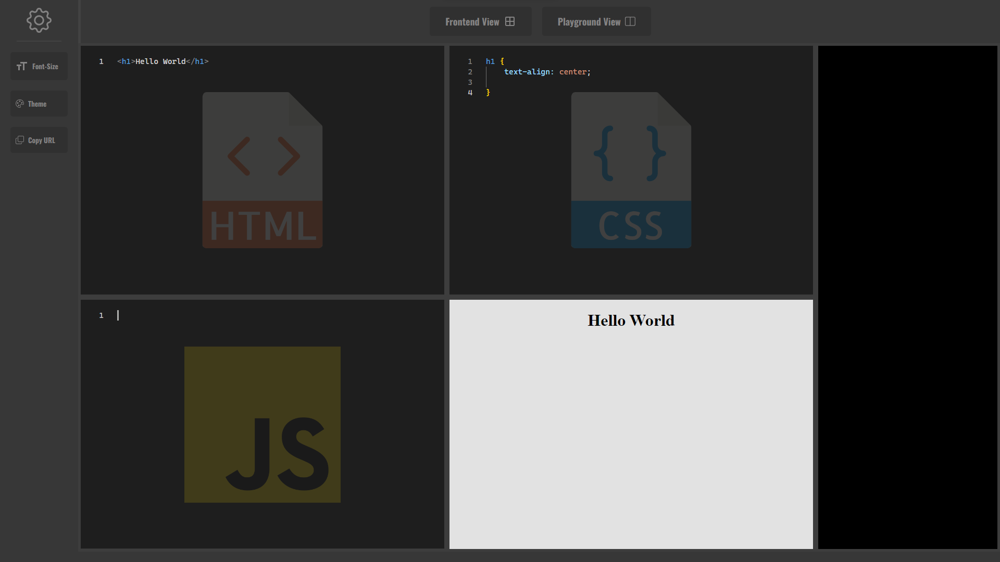

# Cody Studio

A playground to test your JavaScript, CSS, and HTML skills.


 
### 🌐 Website : https://cody-studio.netlify.app
### 💻 Backend-Code : https://github.com/arr199/Simple-API-Server/blob/main/Routes/cody.js
## Features 

- **Coding in JS, CSS, and HTML** -  Users can write and edit their JavaScript, CSS, and HTML code all in one place.
- **Live Website Preview**  -  See your website come to life in real time, making it easy to test and refine your design.
- **Interactive Console** - Expand logged objects, filter by logs, warnings or errors, render `console.table`, and run JavaScript inside your page from the prompt.
- **Customization** -  You can change the theme and font size to match your preferences, ensuring a comfortable and visually appealing environment.
- **Flexible Workspace** - A tabbed editor beside the live preview, with a console drawer below. Drag the handles to resize; Cody Studio remembers your layout.
- **Console View** - Just trying out some JavaScript? Switch the editor bar from Web to Console for a JS editor beside a full-height console. Links with only JS open this way.
- **Device Preview** - Check your page at phone, tablet or any custom width, view it fullscreen, or open it in its own tab.
- **Works on Phones** - On small screens, a tab bar switches between the editors, the preview and the console.
- **Run Control** - Code runs as you type, or switch auto-run off and run it when you're ready with the Run button or Ctrl/Cmd+Enter. Cody Studio remembers your choice.
- **npm Packages** - `import confetti from 'canvas-confetti'` just works: packages load from esm.sh, no install. Pin a version with `'pkg@1.9.3'`. If a package can't load, the console says which one and why.
- **Loop Protection** - An accidental infinite loop can't freeze the page: Cody Studio stops it after a second, tells you which line it was on in the console, and runs the rest of your code.
- **Share** - One click saves a snapshot of your code and copies a short link (`/s/k3x9fa2b`) to send a colleague. It opens the same code forever, however long it is.
- **Starter Examples** - The Examples menu shows a live preview of each example before you load it: a demoscene-style intro, flexbox cards, fireflies on a canvas, a cork-board to-do app, and a mission-control panel that imports an npm package. Cody Studio opens on empty editors, and Back takes you from an example to your previous code.

> **Note:** The preview runs in a sandboxed iframe, so code from a shared link can't reach the app or your data. As a result, `localStorage`, `sessionStorage` and cookies aren't available to code in the preview.

## Development

```sh
pnpm install
pnpm dev        # start the dev server
pnpm build      # production build into dist/
pnpm lint       # ESLint
pnpm test       # unit tests (Vitest)
pnpm test:e2e   # browser tests (Playwright, uses your installed Google Chrome)
```

Sharing needs a Postgres database. Locally it runs in Docker:

```sh
docker compose up -d   # Postgres with the cody and cody_test databases
cp .env.example .env   # DATABASE_URL for the local database
pnpm dev:api           # the app plus the real API, through the Vercel CLI (vercel login, vercel link once)
pnpm test:api          # API tests (test:api and test:e2e need Docker running)
```

## Built With 
  
- [JavaScript](https://www.javascript.com/) - The language that powers the World Wide Web.
- [HTML](https://www.w3schools.com/html/) - The standard markup language for creating web pages.
- [CSS](https://www.w3.org/Style/CSS/Overview.en.html) - Allows you to create great-looking web pages.
- [Monaco-Editor](https://www.npmjs.com/package/monaco-editor#monaco-editor) -  The text editor that powers VS Code.
- [NodeJs](https://nodejs.org/en) - A JavaScript runtime environment.
- [ExpressJs](https://expressjs.com/) - A web framework for NodeJs.
- [MongoDB Atlas](https://www.mongodb.com/docs/atlas/) - A multi-cloud database service.
- [Vite](https://vitejs.dev/) - A tool that is used for building fast and optimized web applications.
  


