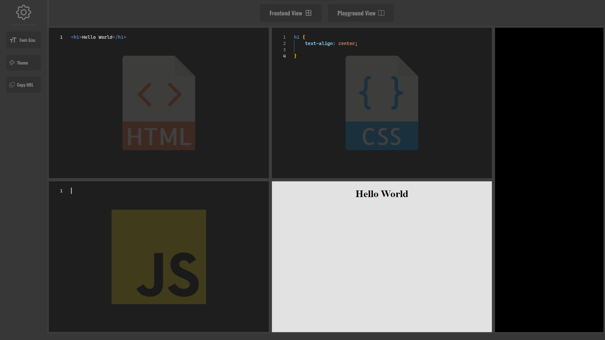

# Cody

A playground to test your JavaScript, CSS, and HTML skills.


 
### 🌐 Website : https://cody-studio.netlify.app
### 💻 Backend-Code : https://github.com/arr199/Simple-API-Server/blob/main/Routes/cody.js
## Features 

- **Coding in JS, CSS, and HTML** -  Users can write and edit their JavaScript, CSS, and HTML code all in one place.
- **Live Website Preview**  -  See your website come to life in real time, making it easy to test and refine your design.
- **Console Interaction** - The console is right there, ready to display error messages, logs, and responses, helping you perfect your code.
- **Customization** -  You can change the theme and font size to match your preferences, ensuring a comfortable and visually appealing environment.
- **Dual Viewing Modes** - Switch between the frontend view (to see your website) and the playground view (for JavaScript editing and console), allowing you to focus on what matters most at any given moment.
- **URL Sharing**  - A single click allows you to copy the URL, making it simple to showcase your work to colleagues or friends.

> **Note:** The preview runs in a sandboxed iframe, so code from a shared link can't reach the app or your data. As a result, `localStorage`, `sessionStorage` and cookies aren't available to code in the preview.

## Development

```sh
pnpm install
pnpm dev        # start the dev server
pnpm build      # production build into dist/
pnpm lint       # ESLint
pnpm test       # unit tests (Vitest)
pnpm test:e2e   # browser tests (Playwright, uses your installed Google Chrome)
```

## Built With 
  
- [JavaScript](https://www.javascript.com/) - The language that powers the World Wide Web.
- [HTML](https://www.w3schools.com/html/) - The standard markup language for creating web pages.
- [CSS](https://www.w3.org/Style/CSS/Overview.en.html) - Allows you to create great-looking web pages.
- [Monaco-Editor](https://www.npmjs.com/package/monaco-editor#monaco-editor) -  The text editor that powers VS Code.
- [NodeJs](https://nodejs.org/en) - A JavaScript runtime environment.
- [ExpressJs](https://expressjs.com/) - A web framework for NodeJs.
- [MongoDB Atlas](https://www.mongodb.com/docs/atlas/) - A multi-cloud database service.
- [Vite](https://vitejs.dev/) - A tool that is used for building fast and optimized web applications.
  


